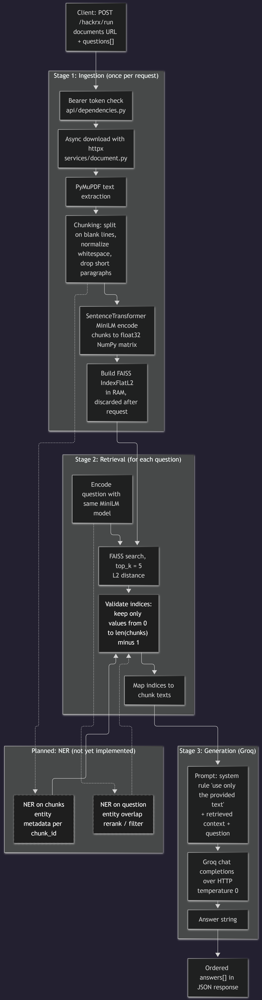

# RAG Pipeline Architecture

## Overview: What is RAG?
**Retrieval-Augmented Generation (RAG)** is an AI framework that improves the accuracy and reliability of generative AI models by fetching facts from an external knowledge base before generating a response. 

### How It Works:
1. **Ingestion & Indexing:** Documents and data sources are split into smaller chunks, converted into vector embeddings, and stored in a vector database.
2. **Retrieval:** When a user asks a query, the system searches the vector database to retrieve the most contextually relevant document chunks.
3. **Augmentation & Generation:** The retrieved context is combined with the original user prompt and fed into the Large Language Model (LLM) to produce an accurate, grounded, and up-to-date answer.
